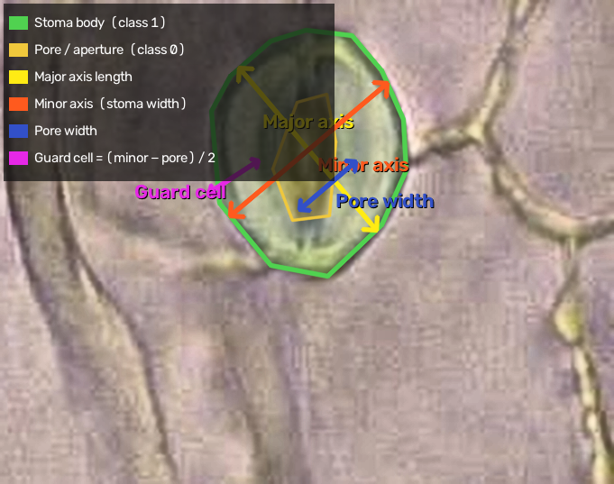

## Biological Background

Stomata are microscopic pores on leaf surfaces, each flanked by a pair of **guard cells**. Their geometry is a key indicator of plant physiology: stomatal size and aperture regulate gas exchange (CO₂/O₂) and water loss (transpiration). Accurate morphometric measurements allow researchers to:

-   Compare stomatal morphology across genotypes, species, or treatments
-   Quantify stress responses (drought, heat) through pore aperture changes
-   Estimate stomatal conductance from geometric proxies

------------------------------------------------------------------------

## Annotated Diagram

The figure below shows a single stoma from a real brightfield microscopy image (training dataset), with the YOLO segmentation polygons and all four measurement lines overlaid. The **green outline** is the stoma body mask (class 1); the **cyan outline** is the pore/aperture mask (class 0):

{fig-align="center" width="80%"}

------------------------------------------------------------------------

## Trait Definitions

PSCA reports every measurement in **both pixels and micrometres (µm)**. Pixel-to-micrometre conversion uses the calibration constant:

$$
\text{PX\_TO\_UM} = \frac{50.0\,\mu\text{m}}{451.3958\,\text{px}} \approx 0.1108\,\mu\text{m/px}
$$

::: callout-note
This calibration is specific to the microscope/objective used by the Pollination Ecology Group. If you change optics, update `PX_TO_UM` in `src/extract_traits.py`.
:::

------------------------------------------------------------------------

### 1. Major Axis Length (`major_axis_len_um`)

:::: metric-card
<h4>📏 Major Axis — Full Stoma Length</h4>

<p>The <strong>longest dimension</strong> of the minimum-area bounding rectangle fitted around the stoma mask. This corresponds to the longitudinal axis of the stoma, typically oriented parallel to the epidermal cell rows.</p>

::: metric-formula
stoma_major_length_px = max(rect_width, rect_height) → × PX_TO_UM
:::
::::

**How it is computed:** `cv2.minAreaRect()` fits the tightest possible rotated rectangle around the stoma polygon. The longer of the two rectangle sides is taken as the major axis.

**Biological meaning:** Reflects overall stoma size. Larger stomata are associated with polyploidy, shade adaptation, and certain stress responses.

------------------------------------------------------------------------

### 2. Minor Axis Length (`minor_axis_len_um`)

:::: metric-card
<h4>📏 Minor Axis — Full Stoma Width</h4>

<p>The length of the <strong>minor axis line</strong> (perpendicular to the major axis) where it intersects the full stoma outline. Measured by projecting the minor-axis direction through the stoma polygon.</p>

::: metric-formula
stoma_minor_length_px = minor_axis_line ∩ stoma_polygon → length → × PX_TO_UM
:::
::::

**How it is computed:**

1.  The minor axis direction is extracted from the bounding rectangle angle.
2.  An infinitely long line is cast through the stoma centroid along that direction.
3.  The intersection of this line with the stoma polygon gives the chord length = minor axis.

**Biological meaning:** Width of the closed stoma. Together with the major axis, this gives a shape index (eccentricity / aspect ratio).

------------------------------------------------------------------------

### 3. Pore Minor Length (`pore_minor_len_um`)

:::: metric-card
<h4>🔵 Pore Width — Aperture Diameter</h4>

<p>The width of the <strong>central pore (aperture)</strong> measured along the same minor axis direction as above. PSCA detects the pore as a separate segmentation class and intersects it with the same minor axis line.</p>

::: metric-formula
center_minor_length_px = minor_axis_line ∩ pore_polygon → length → × PX_TO_UM
:::
::::

**How it is computed:** The model segments the pore as class `0` (center) and the full stoma as class `1`. The pore polygon is intersected with the same minor axis line used for the stoma.

**Biological meaning:** The most ecophysiologically important trait — directly proportional to stomatal conductance (g_s). A wider pore = higher gas exchange and transpiration.

------------------------------------------------------------------------

### 4. Guard Cell Width (`guard_cell_width_um`)

:::: metric-card
<h4>🟢 Guard Cell Width — Thickness of One Guard Cell</h4>

<p>Estimated as half the difference between the stoma width and the pore width along the minor axis. Represents the radial thickness of a single guard cell.</p>

::: metric-formula
guard_cell_width_px = (stoma_minor_length_px − pore_minor_length_px) / 2 → × PX_TO_UM
:::
::::

**How it is computed:** Since the minor axis passes through both guard cells symmetrically, the stoma width = pore width + 2 × guard cell width.

**Biological meaning:** Guard cell thickness correlates with turgor potential and mechanical properties of the cell wall. Thicker guard cells tend to open with less turgor.

------------------------------------------------------------------------

## Output CSV Schema

Each row in the output CSV represents **one detected stoma** from one image:

| Column                | Type   | Unit | Description                       |
|-----------------------|--------|------|-----------------------------------|
| `image_name`          | string | —    | Source image filename             |
| `s3_key`              | string | —    | Full S3 object path               |
| `stoma_idx`           | int    | —    | Index of stoma within image       |
| `major_axis_len_px`   | float  | px   | Major axis in pixels              |
| `major_axis_len_um`   | float  | µm   | Major axis in micrometres         |
| `minor_axis_len_px`   | float  | px   | Minor axis (stoma) in pixels      |
| `minor_axis_len_um`   | float  | µm   | Minor axis (stoma) in micrometres |
| `pore_minor_len_px`   | float  | px   | Pore width in pixels              |
| `pore_minor_len_um`   | float  | µm   | Pore width in micrometres         |
| `guard_cell_width_px` | float  | px   | Guard cell width in pixels        |
| `guard_cell_width_um` | float  | µm   | Guard cell width in micrometres   |

: Output CSV column schema {.striped .hover}

------------------------------------------------------------------------

## Example Output Rows

``` csv
image_name,stoma_idx,major_axis_len_px,major_axis_len_um,minor_axis_len_px,minor_axis_len_um,pore_minor_len_px,pore_minor_len_um,guard_cell_width_px,guard_cell_width_um
leaf_01_tile_003.jpg,0,312.4,34.63,198.7,22.02,87.3,9.68,55.7,6.17
leaf_01_tile_003.jpg,1,305.1,33.82,191.2,21.19,74.1,8.21,58.6,6.49
leaf_01_tile_007.jpg,0,289.6,32.10,183.5,20.34,65.8,7.30,58.9,6.52
```

::: callout-tip
## Downstream analysis

Load this CSV directly in R with `read.csv()` or in Python with `pd.read_csv()`. The `_um` columns are ready for statistical modelling without further conversion.
:::

------------------------------------------------------------------------

## Detection Logic — Stoma ↔ Pore Matching

Because the model segments stoma bodies and pores as separate objects, PSCA needs to pair them:

``` python
# Primary: pore centroid must fall inside the stoma polygon
for center in centers:
    if stoma.contains(center.centroid):
        matched_center = center
        break

# Fallback: nearest pore within 100 px
if not matched_center and centers:
    distances = [stoma.centroid.distance(c.centroid) for c in centers]
    if min(distances) < 100:
        matched_center = centers[np.argmin(distances)]
```

Only stomata with a matched pore contribute a row to the CSV. Stomata where no pore was detected are silently skipped.