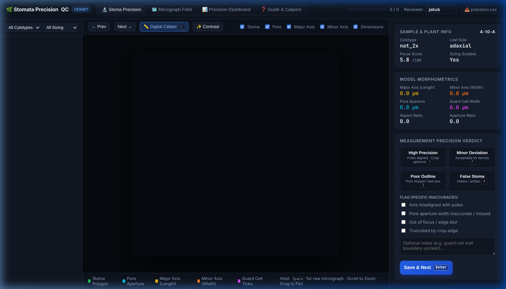
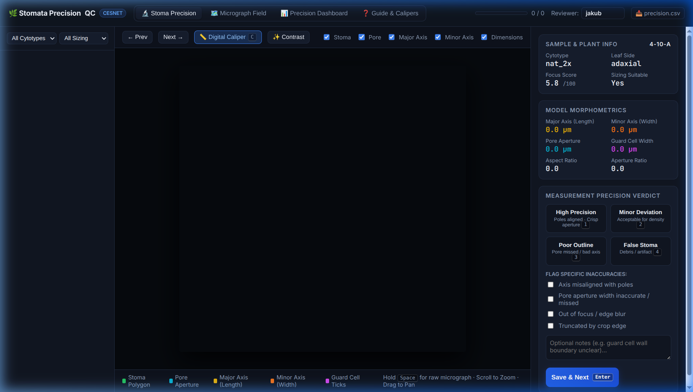
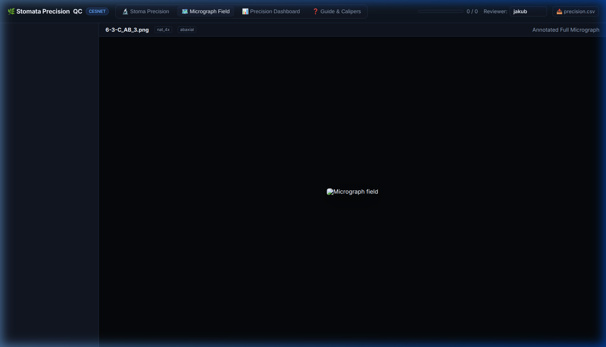
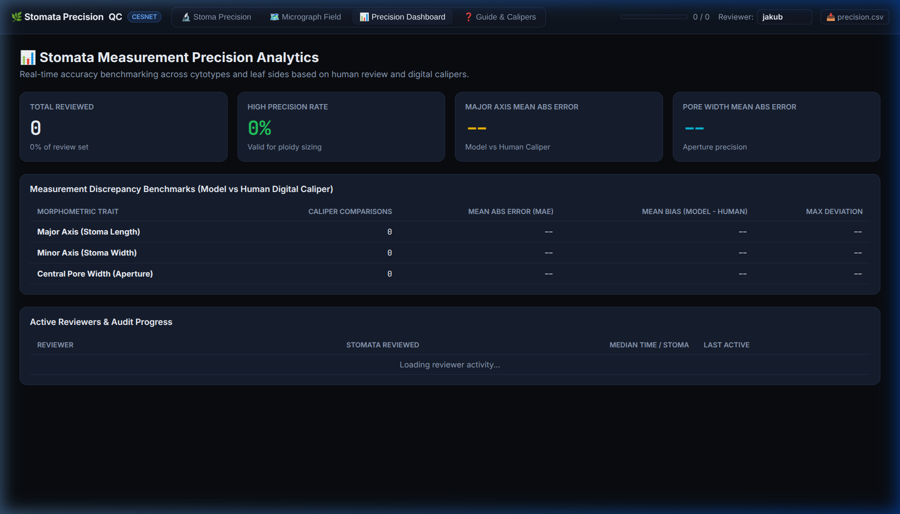

::: {.callout-important}
## 🌐 Shareable CESNET App Link
The Stomata QC and Measurement Precision application is live on the CESNET cloud infrastructure:

**Public URL:** [**https://stomata-review-stenc.dyn.cloud.e-infra.cz**](https://stomata-review-stenc.dyn.cloud.e-infra.cz)

Hosted in the `stenc-ns` Kubernetes namespace with automatic Let's Encrypt TLS encryption, matching the established `pollen-review` and `viability-review` infrastructure.
:::

---

## Overview & Purpose

In automated plant morphometry, the central question for downstream ecological and evolutionary analysis is: **How precise is the automated measurement?**

The **Stomata Precision QC App** provides researchers and collaborators with a dedicated, interactive web environment to directly evaluate:
1. **Segmentation accuracy:** Does the YOLO segmentation polygon tightly and faithfully follow the outer guard cell boundary and inner aperture?
2. **Measurement axis alignment:** Does the major axis strictly span between the two stomatal poles? Does the minor axis line pass through the exact center of maximum pore width?
3. **Pore aperture precision:** Is the central aperture opening accurately measured, even for challenging, narrow, or partially closed stomatal pores?
4. **Ploidy suitability gate:** Does the stoma meet strict biometric criteria for cell size comparison across ploidy levels (`is_suitable_for_ploidy_sizing`), or is it only valid for stomatal density counting?
5. **Human ground-truth benchmarking:** Using the built-in **Digital Caliper Tool**, researchers can manually measure stomata on screen and immediately quantify the model's Mean Absolute Error (MAE) and bias in micrometres ($\mu\text{m}$).

---

## Key Features & Interface Tour

### 1. High-Magnification Stoma Precision View

The primary workspace provides an interactive HTML5 canvas with continuous smooth zoom ($1\times$ to $8\times$) and drag-to-pan navigation to closely inspect individual stomata at sub-pixel resolution.

{fig-align="center" width="95%"}

#### Vectorized Anatomical Overlays

The canvas overlays the mathematical measurement vectors calculated by the pipeline:

| Layer | Color Code | Biological Meaning | Mathematical Calculation |
|---|---|---|---|
| **Stoma Body** | Green (`#22c55e`) | Outer boundary of guard cell pair | YOLO Class 1 segmentation polygon |
| **Pore Aperture** | Cyan (`#06b6d4`) | Central aperture opening | YOLO Class 0 central polygon |
| **Major Axis** | Yellow (`#eab308`) | Longitudinal stoma length ($L_{\text{maj}}$) | Minimum bounding rectangle long axis ($\mu\text{m}$) |
| **Minor Axis** | Orange (`#f97316`) | Full transverse stoma width ($L_{\text{min}}$) | Orthogonal chord through centroid ($\mu\text{m}$) |
| **Pore Width** | Cyan Line (`#06b6d4`) | Transverse pore aperture diameter ($P_w$) | Line intersection with pore boundary ($\mu\text{m}$) |
| **Guard Cell Width** | Magenta (`#d946ef`) | Radial thickness of single guard cell | $(L_{\text{minor}} - P_{\text{width}}) / 2$ ($\mu\text{m}$) |

::: {.callout-tip}
- **Hold `Space`:** Instantly hides all vector overlays to inspect the raw, unfiltered microscopy image.
- **Press `X`:** Toggles CLAHE (Contrast-Limited Adaptive Histogram Equalization) to enhance faint guard cell walls in lower-contrast images.
:::

---

### 2. Interactive Virtual Digital Caliper (<kbd>C</kbd>)

The app features an integrated **Digital Caliper Tool** allowing researchers to independently measure any anatomical dimension with precision crosshairs directly on the crop canvas.

{fig-align="center" width="95%"}

#### How to Benchmark Measurement Precision:
1. Click **📏 Digital Caliper** (or press <kbd>C</kbd>).
2. Click and drag across the stoma poles (for length), across the stoma waist (for width), or across the pore opening.
3. The **Caliper HUD** displays:
   - Measured physical distance in $\mu\text{m}$ (using the calibration $\text{PX\_TO\_UM} \approx 0.1107675\,\mu\text{m/px}$).
   - Quick buttons: **Set Major**, **Set Minor**, or **Set Pore** to record the ground truth comparison.
4. The system calculates the exact discrepancy:
   $$\Delta = \text{Model} - \text{Human}\quad (\mu\text{m})$$
   $$\text{Error } \% = \frac{|\text{Model} - \text{Human}|}{\text{Human}} \times 100\%$$

---

### 3. Panoramic Micrograph Field Explorer

Switching to the **Micrograph Field** tab allows researchers to step back and inspect the full $3096 \times 4140$ px brightfield microscopy slide with all detected stomata annotated.

{fig-align="center" width="95%"}

Researchers can verify field-level characteristics:
- Spatial distribution and clustering (Clark-Evans dispersion index)
- Epidermal quality, focus variation across the leaf surface, air bubbles, and staining artifacts
- Jump directly to any slide or plant ID from the left sidebar

---

### 4. Precision Benchmark Analytics Dashboard

The **Precision Dashboard** tab compiles real-time accuracy benchmarks across all reviewer evaluations and caliper measurements.

{fig-align="center" width="95%"}

#### Available Benchmarks & Telemetry:
- **Precision Classification Rate:** Percentage of stomata verified as *High Precision* vs *Minor Deviation* vs *Poor Measurement*.
- **Mean Absolute Error (MAE):** Average deviation in $\mu\text{m}$ between automated model measurements and human digital caliper measurements for Major Axis, Minor Axis, and Pore Width.
- **Mean Bias:** Identifies whether the automated model tends to systematically over- or under-estimate pore aperture or cell width.
- **Reviewer Progress & Audit Trail:** Number of stomata reviewed per collaborator, median time per evaluation, and timestamps.
- **One-Click CSV Export:** Direct download of [`precision.csv`](https://stomata-review-stenc.dyn.cloud.e-infra.cz/api/export/precision.csv) for statistical analysis in R or Python.

---

## Rapid Review Workflow & Keyboard Shortcuts

To enable rapid quality control of hundreds of stomata without mouse fatigue, all key actions are bound to single keystrokes:

| Shortcut | Action | Description |
|---|---|---|
| <kbd>1</kbd> | **High Precision** | Poles aligned, aperture crisp, verified for ploidy sizing |
| <kbd>2</kbd> | **Minor Deviation** | Acceptable for density counting, slight angle or edge deviation |
| <kbd>3</kbd> | **Poor Measurement** | Significant outline error, pore missed, or severe distortion |
| <kbd>4</kbd> | **False Stoma** | Non-stoma epidermal debris, air bubble, or artifact |
| <kbd>Enter</kbd> | **Save & Next** | Saves decision to CESNET S3 and advances to next stoma |
| <kbd>C</kbd> | **Digital Caliper** | Toggles virtual caliper crosshairs for manual measurement |
| <kbd>X</kbd> | **Contrast Filter** | Toggles CLAHE contrast boost |
| <kbd>Space</kbd> | **Peek Raw Image** | Hold to temporarily hide overlays |
| <kbd>←</kbd> / <kbd>→</kbd> | **Navigate** | Move to previous / next stoma in the queue |

---

## Cloud Architecture & Storage Integration

The review application operates entirely stateless inside the cluster, persisting all review data directly to the CESNET S3 Ceph object store (`peg-bucket`):

```
s3://peg-bucket/Ostatni/Stomata/Review/
├── manifest.json              # Full dataset manifest with geometric vectors
├── crops/                     # High-resolution 360x360 stoma crops (JPEG)
├── overviews/                 # Scaled panoramic field micrographs (JPEG)
└── decisions/                 # Reviewer decisions and caliper ground truth
    └── {item_id}/
        └── {reviewer}.json    # JSON audit record per item and reviewer
```

Because decisions are committed directly to S3 as individual JSON records, reviews are safely preserved across pod updates or restarts, and multiple team members can review simultaneously without conflicts.

### Deployment & Maintenance

The app can be redeployed or updated with a single script:

```bash
bash deploy_stomata_review.sh
```

This updates the Kubernetes ConfigMap, applies the Deployment and Ingress specifications in `k8s/stomata-review.yaml`, and executes a zero-downtime rolling restart on the CESNET cluster.
